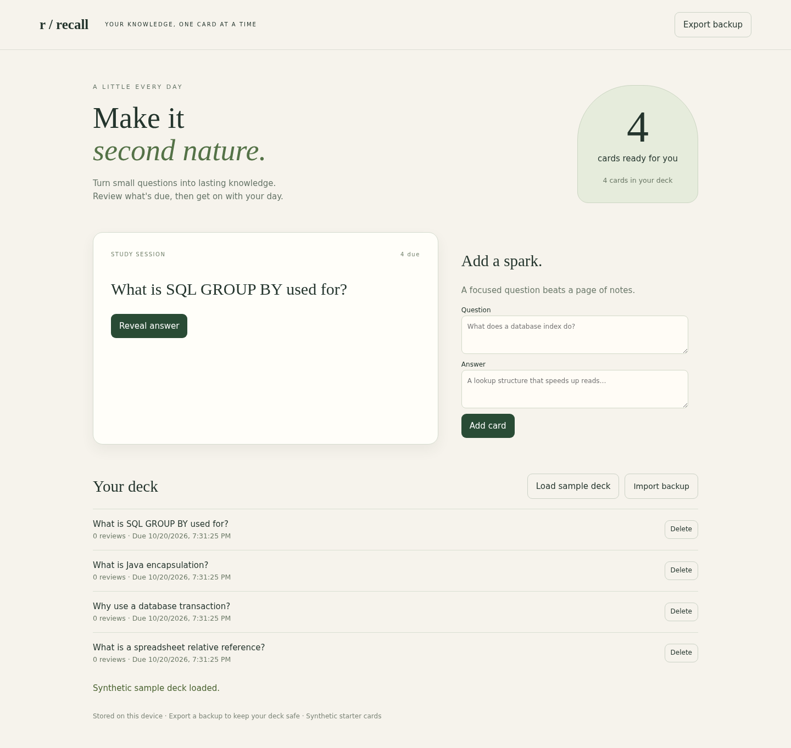
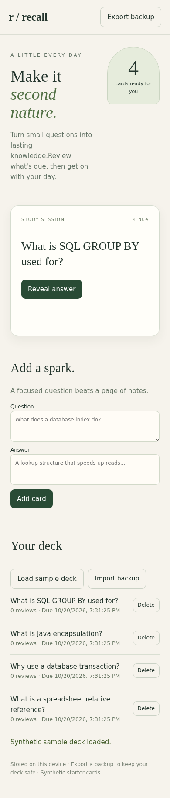

# Recall Study Cards

A local-browser flashcard study desk with due-date scheduling, answer reveal, review grades, add/delete decks and validated JSON backup/import.

## Quick start

```sh
python -m http.server 8081 --bind 127.0.0.1
# Open http://127.0.0.1:8081
```
Node.js 20+ is needed only for tests. No build or npm dependencies. Data stays in this browser's local storage.

## Tests

`node --test tests/*.test.mjs`

## Scope and limitations

Local browser app, not an account/cloud sync service. Export backups before clearing browser storage. The deterministic interval scheduler is a simplified spaced-repetition algorithm, not a learning-outcome guarantee. Dates use UTC instants displayed in local browser time. Import replaces a deck only after confirmation; invalid files leave existing data unchanged.

## Attribution and sample data

Built for Raj's portfolio with Wabi AI assistance. Sample data is invented and labelled synthetic; no real customer, employer or private account records are included. This is a learning/portfolio implementation, not a claim of commercial work or production deployment.

See source and tests for implementation decisions. Use invented data when exploring.

## How it works

Pure model module validates cards and computes due intervals; DOM UI persists versioned state in localStorage and renders input through textContent. Backup import validates before replacing state.

## Verified example

Chromium exercised sample load/reveal/grade/add/reload/export/delete/restore, invalid-import preservation and markup escaping; desktop and390px layouts inspected. No cloud sync or service worker.

See [VALIDATION.md](VALIDATION.md) for tested environments and scope.





## Live demo

Open the browser version at <https://rajtiwari3594.github.io/recall-study-cards/>. It runs entirely in the browser; each visitor's documents or study data stay in that browser and are not synchronized to an account.
